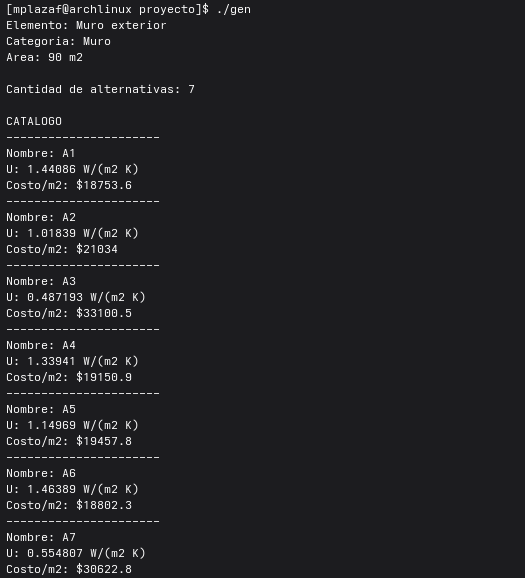
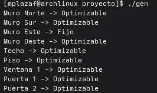

# Proyecto Optimización (INF-292)
## Clases

### Alternativa
### Elemento
### Instancia

## Funciones
A continuación se explica en palabras sencillas qué hace cada función

### generarDimensiones()
Tipo: void (modifica referencias)

Escoge un valor aleatorio para el largo, ancho y altura de una instancia dentro de un rango de valores sacado del ministerio de vivienda y otros asumidos.
### generarUmax()
Retorna: un número
Genera un valor Umax para la vivienda dentro de el rango.
### elegirCategorias()
Retorna: arreglo de categorias (strings)
Si la instancia es pequeña, elige al azar 3 o 4 categorias.
Si la instancia es mediana o grande tiene que devolver todas.
### generarCantidadAlternativas()
Retorna: numero
Dependiendo del tamaño de la instancia, retorna un valor dentro del rango de cantidad de alternativas que dice la pauta.
### generarU()
retorna: Número
Dependiendo del tipo de elemento, retorna un U dentro de un rango asociado a cada tipo.
### generarCosto()
Retorna: numero
Se le entrega un elemento y una categoria y un U. Dependiendo de eso, genera el costo de tal forma que si el U va bajando, el precio va aumentando!
### generarCatalogo()
Retorna : void (modifica a elemento )
Modifica a elemento, agregandole alternativas a su arreglo de alternativas.
### generarElementoFijo
Retorna: void (modifica referencia de elemento)
Como no hay nada que elegir, no tiene alternativas, pero genera un U y un precio y los deja en los atributos Ufijo y costoFijoM2.
### generarELementoOptimizable()
retorna: void (modifica referencia)
Toma un elemento y le genera un catálogo con la función generarCatalogo. Nada más.
###
## Consideraciones lógicas
### Área muros - ventanas - puertas
Se reparte el área de aberturas en los muros entre los 4 muros, es decir no se toma en cuenta la geometría por motivos prácticos.
areaAberturasPorMuro = (areaVentanasTotal + areaPuertasTotal)/ cantidadMuros;

## Cómo ejecutar
1. Descargue todos los archivos y póngalos en la misma carpeta. Abra una terminal en esa carpeta.
2. escriba "make", entonces se habrá generado un ejecutable llamado "gen"
3. escriba "./gen"
4. Para borrar el ejecutable, escriba "make clear".

## Generacion de catalogo de alternativas

## Generacion de elementos


## Entrega 2 - Resolución con MiniZinc

Para la segunda entrega se implementó el modelo de optimización utilizando **MiniZinc**. Las instancias son resueltas mediante el solver **HiGHS**, utilizado como backend para resolver el problema de programación lineal entera mixta.

El objetivo del modelo es seleccionar una alternativa para cada elemento optimizable de la vivienda, minimizando el costo total y respetando el límite máximo de transmitancia térmica global \(U_{\max}\).

### Estructura de archivos

Los principales archivos utilizados en esta etapa son:

```text
proyecto-inf292/
├── generar_dzn.cpp
├── ejecutar_todas.ps1
├── ejecutar_margenes.ps1
├── resultados.csv
├── resultados_margenes.csv
└── minizinc/
    ├── modelo.mzn
    ├── modelo_margenes.mzn
    └── datos/
        ├── pequena_1.dzn
        ├── pequena_2.dzn
        ├── ...
        ├── mediana_1.dzn
        ├── ...
        └── grande_5.dzn
```

Se utilizan 15 instancias en total:

- 5 instancias pequeñas.
- 5 instancias medianas.
- 5 instancias grandes.

### Requisitos

Para ejecutar esta etapa se requiere:

- MiniZinc.
- Solver HiGHS disponible desde MiniZinc.
- PowerShell para ejecutar los experimentos automatizados.
- g++ para compilar el generador de archivos `.dzn`.

Se puede comprobar que MiniZinc está correctamente instalado mediante:

```powershell
minizinc --version
```

Y los solvers disponibles mediante:

```powershell
minizinc --solvers
```

HiGHS debe aparecer dentro de la lista de solvers disponibles.

## Generación automática de archivos DZN

El archivo `generar_dzn.cpp` transforma las instancias generadas por el proyecto al formato de datos utilizado por MiniZinc.

Para compilarlo desde WSL/Linux:

```bash
g++ generar_dzn.cpp generador.cpp validacion.cpp -o generar_dzn
```

Luego ejecutar:

```bash
./generar_dzn
```

Esto genera automáticamente los 15 archivos `.dzn` dentro de:

```text
minizinc/datos/
```

Cada archivo contiene los parámetros necesarios para resolver una instancia, incluyendo las áreas de los elementos, alternativas disponibles, valores de transmitancia térmica, costos, \(U_{\max}\), aporte de los elementos fijos y costo fijo.

## Modelo base

El modelo principal se encuentra en:

```text
minizinc/modelo.mzn
```

Para resolver manualmente una instancia utilizando HiGHS se puede ejecutar, por ejemplo:

```powershell
minizinc --solver HiGHS --statistics minizinc\modelo.mzn minizinc\datos\grande_1.dzn
```

El modelo entrega:

- alternativas seleccionadas;
- costo total óptimo;
- transmitancia térmica obtenida;
- valor de \(U_{\max}\);
- estadísticas del solver.

El símbolo:

```text
==========
```

indica que MiniZinc finalizó la optimización y la solución óptima fue encontrada.

## Ejecución automática de las 15 instancias

El script:

```text
ejecutar_todas.ps1
```

resuelve automáticamente las 15 instancias utilizando MiniZinc con HiGHS.

En PowerShell se ejecuta mediante:

```powershell
powershell -ExecutionPolicy Bypass -File .\ejecutar_todas.ps1
```

Los resultados son almacenados en:

```text
resultados.csv
```

Para cada instancia se registran, entre otras métricas:

- estado de la solución;
- número de variables binarias;
- número de restricciones;
- costo óptimo;
- \(U\) obtenido;
- \(U_{\max}\);
- tiempo de resolución;
- tiempo de generación del modelo;
- nodos explorados;
- cota del objetivo;
- MIP Gap.

## Experimentos con márgenes relativos

Para estudiar el efecto de modificar las restricciones del problema se implementó:

```text
minizinc/modelo_margenes.mzn
```

Se utilizan los siguientes márgenes relativos:

```text
-10%, -5%, 0%, +5%, +10%
```

tanto para el límite de transmitancia térmica como para el límite de costo.

El límite térmico experimental se calcula como:

```text
UmaxExperimental = Umax * (1 + margenU)
```

mientras que el límite de costo se calcula respecto del costo óptimo de la instancia base:

```text
CostoMaximo = CostoReferencia * (1 + margenCosto)
```

Se incorpora además una pequeña tolerancia numérica al límite de costo para evitar problemas producidos por la representación de números de punto flotante.

## Ejecución de los experimentos de margen

El script:

```text
ejecutar_margenes.ps1
```

ejecuta automáticamente todas las combinaciones de márgenes.

Se consideran:

```text
15 instancias
x 5 márgenes de U
x 5 márgenes de costo
= 375 experimentos
```

Para ejecutarlo:

```powershell
powershell -ExecutionPolicy Bypass -File .\ejecutar_margenes.ps1
```

Los resultados se almacenan en:

```text
resultados_margenes.csv
```

Para cada escenario se registra información como:

- instancia;
- margen de \(U_{\max}\);
- margen de costo;
- estado de factibilidad;
- costo de referencia;
- costo máximo permitido;
- costo óptimo obtenido;
- transmitancia térmica obtenida;
- \(U_{\max}\) experimental;
- tiempo de resolución;
- nodos explorados;
- cota del objetivo;
- MIP Gap.

## Resultados generales

Las 15 instancias originales fueron resueltas de forma óptima mediante HiGHS, alcanzando un MIP Gap de 0%.

En los experimentos de márgenes se ejecutaron 375 escenarios:

- 191 escenarios resultaron factibles y alcanzaron solución óptima.
- 184 escenarios resultaron infactibles.

Los experimentos permiten estudiar el compromiso entre costo y desempeño térmico. Al hacer más exigente el límite de transmitancia térmica disminuye la cantidad de soluciones factibles y, en general, aumenta el costo necesario. Por el contrario, al relajar el límite térmico pueden aparecer alternativas de menor costo.

También se observa un aumento del tiempo de resolución al crecer la dimensionalidad de las instancias. Las instancias pequeñas poseen en promedio 24,6 variables binarias, las medianas 121,6 y las grandes 373.